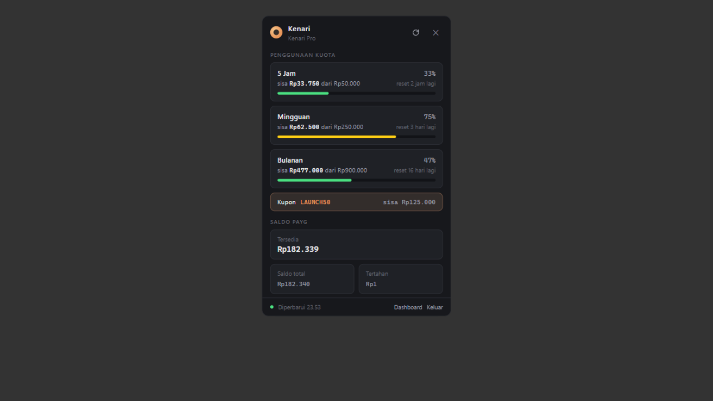

# Kenari Tray

Aplikasi Windows standalone (bukan plugin) yang duduk di system tray dan menampilkan
penggunaan kuota & saldo Kenari saat icon-nya diklik.



## Fitur

- Icon tray berupa **cincin progres**: hijau <50%, kuning <80%, merah ≥80% (mengikuti
  jendela kuota yang paling terpakai: 5 jam / mingguan / bulanan). Tooltip icon menampilkan
  persentase tiap jendela.
- **Klik icon** → popup di dekat tray berisi:
  - Progres kuota **5 jam, mingguan, bulanan** (sisa / budget, %, estimasi waktu reset)
  - Kupon aktif (jika ada)
  - Saldo PAYG: tersedia, total, tertahan
- **Klik kanan icon** → menu Buka / Refresh / Keluar
- Auto-refresh tiap 5 menit; popup tertutup otomatis saat fokus berpindah
- API key disimpan di `%APPDATA%/kenari-tray/kenari-tray-config.json`

## Menjalankan

```bat
npm install        # sekali saja
npm start          # atau dobel-klik "Kenari Tray.bat"
```

Saat pertama jalan tanpa `KENARI_API_KEY`, popup menampilkan form untuk memasukkan
API key (diawali `kn-`). Key disimpan untuk sesi berikutnya. Alternatif: set env var
`KENARI_API_KEY` sebelum menjalankan.

## Autostart bersama Windows (opsional)

Tekan `Win+R` → ketik `shell:startup` → buat shortcut ke `Kenari Tray.bat` di folder itu.

## Struktur

| File | Peran |
|---|---|
| `main.js` | Proses utama Electron: tray, popup window, polling API Kenari, generator icon PNG |
| `popup.html` | UI popup (self-contained CSS/JS) |
| `preload.js` | Bridge IPC aman antara popup dan proses utama |
| `Kenari Tray.bat` | Launcher tanpa jendela console |

Data diambil dari `https://kenari.id/v1/account/quota` dan `/v1/account/balance`
(sama seperti MCP server plugin kenari-quota).
